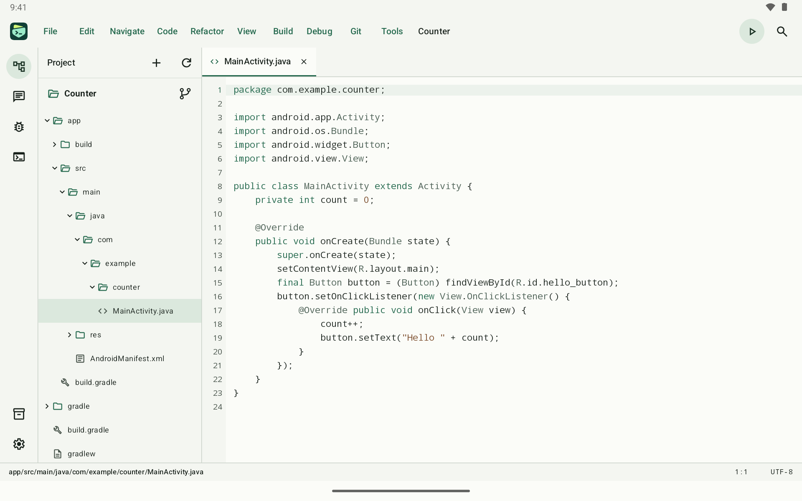

# Pocket Studio

English · [简体中文](README.zh-CN.md)

Pocket Studio is an Android development environment that runs on a phone or tablet. You can edit a project, build an APK and debug it on the same device or on a second Android device. On phones, the bottom bar switches between the project, editor, agent, debugger and build output. At widths of 600 dp or more, the project tree and editor sit side by side.

Pocket Studio runs on Android 8.0 or later. The interface follows the device language and falls back to English. A Simplified Chinese translation is included.



## Getting started

Install the `PocketStudio-<abi>.apk` matching your device (arm64-v8a, armeabi-v7a, x86_64 or x86) from [GitHub Releases](https://github.com/Akaishi-Tech/PocketStudio/releases) or [build it from source](#building-pocket-studio). Open **Plugin store → Development environment** on the welcome screen and install **Android**. This adds Android project templates, SDK Manager, layout preview, build tools and debugging for a second device. The built-in local debugger can install plugins on this device.

Choose **New project → Android project**. Select **Empty Views Activity**, **Button Counter**, or **No Activity**, then choose **Next**. Set the project name, package name, parent folder, compile SDK and minimum SDK. The new project uses the compile SDK as its target SDK. For an Activity, choose Java or Kotlin. **Finish** creates the project in its own folder and opens the Activity source or, for **No Activity**, the manifest. On phones, the workspace’s top-right menu includes **Find action** for looking up commands. Wide screens also have a menu bar.

On Android 11 or later, install the project's Android SDK Platform in **Settings → Gradle and SDK → SDK Manager** to build a debug APK. To use another installed platform for quick builds and Gradle, open **Output → Output options → Build SDK**. The selection applies to the current project. For quick builds of Kotlin projects, also install Kotlin / D8.

| Workspace | What you can do |
| --- | --- |
| Project | Open a folder with the system picker, expand the project tree, create files and folders, find a file by path or search text across files. |
| Editor | Edit Java, Kotlin, XML and Gradle files with line numbers, syntax highlighting and identifier completion. Undo, redo, find and replace text, jump to a line and recover unsaved drafts. |
| Agents | Use Codex in the current project and review chat history, Markdown replies, file operations and build details. |
| Layout preview | Open a layout XML file and choose the **Preview layout** action. The preview supports common Android views and project string, color and dimension resources. |
| Build | Build a single-module Java app offline, package resources, locate compiler errors, sign, export and install the APK. Kotlin projects can use the optional Kotlin / D8 tools. |
| Gradle | Run the project's Gradle Wrapper on the device for builds, tests, lint or custom tasks. |
| Git | Clone or initialize repositories, review diffs and stage files or individual hunks, commit changes, inspect file history and blame, manage branches, tags and stashes, and fetch, pull or push. |
| Devices | Select a target, install an APK, launch an app, run shell commands, filter live Logcat output by text or level, and inspect the target's screen and view hierarchy. |
| Debugger | List debuggable processes, attach to ART, add and remove source breakpoints, inspect the stack and current frame variables, step, resume and detach. |

Choose **Clone repository** on the welcome screen or open Git with the branch icon above the project tree (`Alt+9`). In **Changes**, tap a file to see its diff. For conflicts, pick a version or open the editor to merge changes by hand. Open a branch’s menu to compare, merge or rebase. Open a commit’s menu to cherry-pick, revert or reset.

Clones are stored in the app’s private project storage and appear under **Recent projects**. For a private HTTPS remote, enter a username and access token in the transfer dialog. For SSH, select a private key and a matching OpenSSH `known_hosts` file.

Open Settings with the gear on the welcome screen or from the workspace menu (`Ctrl+Alt+S`). Choose interface and editor fonts independently, preview JetBrains Mono and ligatures, and customize colors for each editor scheme. Search settings to adjust indentation, save actions, Gradle offline mode or console wrapping.

Under **Settings → App updates**, choose **Check for updates** to check GitHub Releases at any time. Automatic updates are enabled by default. When you open or return to the app, Studio checks at most once a day and downloads a newer release on an unmetered network. On a metered network, you choose whether to download it. Studio verifies the APK before you confirm installation in Android.

Choose **Output → Output options → Build debug APK** to run the quick builder. For a Gradle task, use **Find action** and search for the task name. The Output tab shows the build log. Tap a compiler diagnostic to open the source line. After a successful build, **Install APK** opens the installer and **Export APK** is available in Output options. [On-device build guide](build-support/README.md)

[Phone workspace](docs/screenshots/phone.png) · [Debugger](docs/screenshots/debugger.png)

## Using Codex in a project

Open **Agents → Plugin store** to browse agent plugins, or open **Plugin store** from the welcome screen to see all categories. Open a plugin to see its icon, developer and description. Choose **Install** on Codex Plugin to use Codex in the current project. Studio selects the APK matching the device, verifies its size, SHA-256, package, version and signing certificate, and uses local debugging to install it when available. Otherwise Android's package installer opens. The plugin repository publishes separate Codex APKs for ARM64 and x86_64. [Plugin releases](https://github.com/Akaishi-Tech/PocketStudio-Plugins/releases/tag/plugin-store)

Open **Account and usage** in the top-right corner of Agents and choose **Sign in with Codex CLI**. Studio opens the browser on this device. Sign in to ChatGPT there, then return to Studio.

If browser sign-in stalls, return to the Studio sign-in page and choose **Use device code**. Open the verification page and enter the one-time code shown in Studio. If device-code login is disabled, enable it in your ChatGPT security settings or ask your workspace admin to enable it. [Codex device-code sign-in](https://learn.chatgpt.com/docs/auth#login-on-headless-devices)

If you previously used **Continue with ChatGPT** in Studio, sign in once through the CLI. The account page shows the remaining allowance when Codex reports a usage window. You can also check it on the [Codex usage dashboard](https://chatgpt.com/codex/settings/usage).

To connect with an API key, choose **Use an API key**. Keep the default endpoint for OpenAI or enter the HTTPS base URL of a Responses API–compatible service, such as `https://example.com/v1`. Enter the API key for that service and choose **Save connection**. API usage is billed to the associated API account.

Start a new chat to work with the current project. Codex can list, read and edit files. It asks for confirmation before running Gradle tasks. Expand a tool summary to inspect its actions and results. The editor keeps unsaved drafts and reports conflicts when a file changes on disk.

Ask Codex to find text across saved project files, or select code in the editor and ask about “this selection.” It can read the active tab and nearby unsaved edits. With a debug device connected, it can also inspect the foreground screen’s controls and bounds or read recent logs for your app. Logcat uses the application ID from the current project’s built APK by default. If you haven’t built it in Studio, include the installed application ID in your question. After updating Studio, start a new chat to access newly added tools.

[Chat and tool details on a phone](docs/screenshots/agents.png)

## Installing and debugging on the same device

**Install an APK.** After a successful build, install the APK from the build output and confirm in the system installer. On first use, Android may ask you to allow Pocket Studio to install unknown apps. You can also tap an APK in the project tree. Local installation works on Android 8.0 or later with Developer options turned off.

**Debug an app on the same device.** On Android 11 or later, connect to Wi-Fi and follow these steps.

1. Connect to Wi-Fi, open a project and choose **Debug → Debug this device**. Open pairing settings and allow notifications when prompted.
2. In Android's **Developer options → Wireless debugging**, enable wireless debugging and tap **Pair device with pairing code**. Leave the system dialog open, pull down the notification shade and reply to the Studio notification with the six-digit code.
3. Studio discovers the local connection port after pairing. Tap a Java or Kotlin line number to set a breakpoint, then open the play button at the top right and choose **Debug run**. Studio builds the APK, installs it, launches the app and attaches the debugger. The session notification lets you return to the debugger, step over or resume a paused app, or detach.
4. On subsequent sessions, enable wireless debugging and choose **Debug this device** to reconnect using the saved key. Remove the device from the paired devices list in Settings to revoke access.

## Debugging a second Android device

1. Enable USB debugging in Developer options on the target. Use a data-capable USB cable and connect the devices with the phone running Pocket Studio acting as the USB host.
2. Choose **Connect USB** in the Debug tab. Select the target, grant USB access on the host and accept the debugging authorization on the target.
3. Open matching Java or Kotlin source and tap an executable line number. The breakpoint is saved with the project and can be set before connecting.
4. Tap the play button and select **Debug run** to build, install, launch and attach. Choose **Run** for a regular launch. For an already running debuggable app, use **Attach process** in the Debug tab.
5. Trigger that line on the target. On the host, inspect the suspended thread's stack and variables, step or resume. In the sample app, set a breakpoint on `count++;` and tap the target app's button.

For a wireless connection, put both devices on the same LAN. On the target, open **Developer options → Wireless debugging → Pair device with pairing code**. Use wireless pairing on the host with the target's pairing port and six-digit code. After pairing, connect through the port on the target's main Wireless debugging screen. Already paired devices can reconnect directly through this port. [Wireless debugging and verification](docs/wireless-debugging.md)

Production Android devices expose processes whose apps allow debugging. Source breakpoints and variable inspection require the corresponding debug information in the APK. The ADB TCP option supports development emulators and devices already listening for classic TCP connections. [Android debugging guide](https://developer.android.com/studio/debug)

## AOSP sources

Pocket Studio uses the AOSP release tag `studio-2026.2.2`. Android Studio's plugin lives in `tools/adt/idea`, the IntelliJ platform in `tools/idea`, and the Android tools libraries in `tools/base`. The mobile app uses AOSP's ddmlib log levels, resource filename validation rules and Android build tools. Its workspace uses Jetpack Compose and the Android USB Host API. Desktop features such as full IntelliJ semantic indexing and refactoring, Compose preview, Profiler, LLDB/C++ debugging, AVD management and the desktop plugin system remain outside the mobile port. [Pinned revisions, licenses and checkout instructions](upstream/README.md)

## Building Pocket Studio

Install JDK 17 or 21, Android SDK Platform 37 and matching Build Tools on your development machine. Set `ANDROID_HOME` or put `sdk.dir` in `local.properties`. From the checkout root, initialize the AOSP tools dependency, then build the host and Android plugin for your device.

```sh
git submodule update --init --depth 1 -- upstream/release/tools/base
./gradlew :app:assembleArm64V8aDebug :android-plugin:assembleArm64V8aDebug :app:lintArm64V8aDebug
```

Install the host and plugin on an ARM64 device.

```sh
adb install -r app/build/outputs/apk/arm64V8a/debug/app-arm64V8a-debug.apk
adb install -r build-support/android-plugin/build/outputs/apk/arm64V8a/debug/android-plugin-arm64V8a-debug.apk
```

For another architecture, choose the corresponding Gradle flavor (`armeabiV7a`, `x86_64` or `x86`). `:app:assembleRelease` builds all four architectures.

The two-device tests also use ADB and two running test emulators. They install a sample on the target and exercise Logcat, process discovery, breakpoints, stack inspection, variables, stepping, resuming and detaching. The USB tests cover packet framing, disconnects, concurrency and Android Keystore signatures. A separate end-to-end test uses Android's USB Host permission dialog and virtual bulk endpoints on two independent emulators. Physical OTG cables, role negotiation and vendor drivers still need testing on real devices. [USB test setup and results](docs/usb-verification.md)

```sh
tools/test/jdwp/run.sh
tools/test/usb/run.sh emulator-HOST
tools/test/two-emulators.sh emulator-HOST emulator-TARGET
```

## Licenses

Pocket Studio's original code is available under the [MIT license](LICENSE). AOSP code and other bundled components retain their respective licenses. Open **Open-source licenses** from the welcome screen or **Find action** to read them on the device. [AOSP source notes](upstream/README.md) · [Third-party notices](build-support/assets/licenses/)
