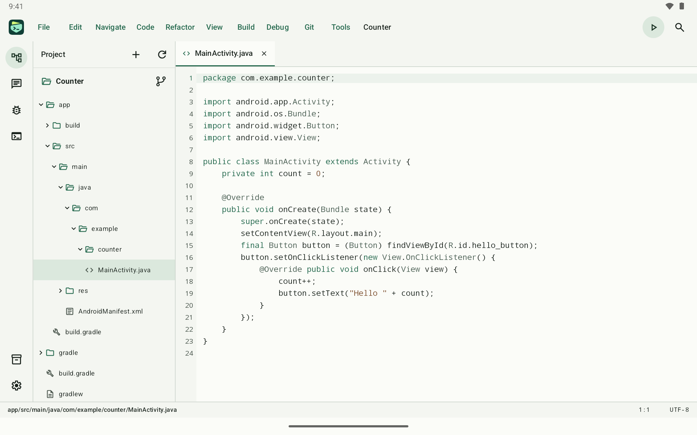

# 掌上 Studio

[English](README.md) · 简体中文

一个运行在 Android 手机上的原生开发环境。手机用底部导航切换项目、编辑器、智能体、调试和输出，可用宽度达到 600 dp 时，项目树和工作区并排显示。应用可安装在 Android 8.0 及以上版本。界面随系统语言切换，提供简体中文，其他未支持的语言使用英文。

## 开始使用

在欢迎页或「文件」菜单点「新建项目」，选择「空白视图 Activity」「按钮计数器」或「无 Activity」，然后点「下一步」。填写项目名称和包名，选择父文件夹与最低 SDK。含 Activity 的模板还可选择 Java 或 Kotlin。点「完成」后，Studio 会创建同名文件夹并打开 Activity 源文件。选择「无 Activity」时会打开清单文件。

在 Android 11 及以上设备上，可在 SDK Manager 安装 SDK Platform 34，然后构建调试 APK。快速构建 Kotlin 项目还需安装 Kotlin / D8。

可从 [GitHub Releases](https://github.com/Akaishi-Tech/PocketStudio/releases) 下载并安装主应用 `PocketStudio.apk`，也可以[从源码构建](#从源码构建及验证)。

| 工作区 | 功能 |
| --- | --- |
| 项目 | 系统目录授权、可展开的项目树、新建目录和文件、按路径查找、跨文件文本搜索 |
| 编辑器 | Java、Kotlin、XML 和 Gradle 文本编辑、行号、语法着色、标识符补全、撤销与重做、查找与替换、跳行、未保存草稿恢复 |
| 智能体 | 在当前工程中使用 Codex，查看聊天记录、Markdown 回复、文件操作和构建详情 |
| 布局 | 打开资源布局 XML，从「视图 → 预览布局」查看原生视图。支持常用控件及项目内的字符串、颜色和尺寸 |
| 构建 | 手机内离线编译单模块 Java 工程、打包资源、签名、定位编译错误、导出及安装 APK。安装可选的 Kotlin / D8 工具后也可编译 Kotlin 工程 |
| Gradle | 在手机上运行工程自身的 Gradle Wrapper，执行构建、测试、Lint 或自定义任务 |
| Git | 克隆或初始化仓库，查看差异、按文件或区块暂存并提交，查看文件历史与逐行作者，管理分支、标签和储藏，抓取、拉取和推送 |
| 设备 | 选择目标、安装 APK、启动应用、执行 Shell、流式 Logcat 及文本和级别过滤、目标设备屏幕与控件检查 |
| 调试器 | 列出可调试进程、附加 ART、设置和移除多个源码行断点、检查栈和当前帧变量、单步执行、继续和分离 |

从欢迎页选择「克隆仓库」，或在项目树顶端点分支图标打开 Git（`Alt+9`）。在「更改」中点文件即可查看差异。遇到冲突时，可选择保留的版本，也可打开编辑器手动合并。分支比较、合并和变基位于「分支」页，拣选、还原和重置位于对应提交的操作菜单。

克隆的仓库存放在应用专用目录中，可从「最近项目」重新打开。私有 HTTPS 仓库可在传输对话框中填写用户名和访问令牌。使用 SSH 时，选择私钥和包含服务器公钥的 OpenSSH `known_hosts` 文件。

在欢迎页点齿轮，或从工作区打开「文件 → 设置」（`Ctrl+Alt+S`）。界面和编辑器可分别选择字体。编辑器支持 JetBrains Mono、字体连字和配色预览，每种方案单独保存自定义颜色。设置页还可搜索缩进、保存时清理、Gradle 离线模式和控制台换行等选项。

在「设置 → 应用更新」中，点「检查更新」可随时查询 GitHub Releases 正式版。自动更新默认开启，打开应用或返回前台时每天最多检查一次。发现新版后，Studio 会在非计费网络上自动下载，在计费网络上会先询问。安装包校验通过后，由你在 Android 系统界面确认安装。

「构建调试 APK」使用手机内置的快速构建器。需要执行项目定义的任务时，打开「构建」，选择 Gradle 任务并点击「在本机运行」。任务日志显示在「构建输出」。[本机构建说明](build-support/README.zh-CN.md)

## 在项目中使用智能体

打开项目后点「智能体 → 下载 Codex」。Studio 从本仓库 GitHub Release 的固定标签 `codex-runtime` 下载已签名的 `PocketStudio-Codex.apk`，核对文件大小、SHA-256、包名和签名证书后打开系统安装器。插件显示为「掌上Studio - Codex插件」，内含 ARM64 和 x86_64 的原生 Codex。也可以从同一版本的发布页下载两个 APK 并分别安装。再次进入「智能体」时会检查插件更新，由你选择何时安装。

在「智能体」右上角打开「账户与用量」，点「通过 Codex CLI 登录」。Studio 会打开本机浏览器。在浏览器中登录 ChatGPT，完成后返回 Studio 即可使用该账户。

如果浏览器登录未能完成，回到 Studio 登录页，点「使用设备码」。打开验证页面，输入 Studio 显示的一次性验证码。如果设备码登录已停用，请在 ChatGPT 的安全设置中开启，或请工作区管理员开启。[Codex 设备码登录说明](https://learn.chatgpt.com/docs/auth#login-on-headless-devices)

如果之前在 Studio 用过「使用 ChatGPT 继续」，请通过 CLI 重新登录一次。Codex 返回用量数据后，账户页面会显示当前时段的剩余额度。也可以直接查看 [Codex 用量面板](https://chatgpt.com/codex/settings/usage)。

选择「使用 API 密钥」可连接 API 服务。OpenAI 使用默认 Endpoint。若要连接兼容 Responses API 的其他服务，填写其 HTTPS 基础地址，例如 `https://example.com/v1`。输入该服务的 API 密钥，点「保存连接」。费用计入对应的 API 账户。

点「新聊天」向智能体提问。它可以在当前工程中列出、读取和编辑文件，运行 Gradle 任务前会显示确认。对话中的工具摘要可以展开查看操作和结果。编辑器保留未保存的草稿，文件内容发生冲突时会提示处理。

你可以让 Codex 搜索工程里已保存的文件，也可以在编辑器中选中代码，直接问「这段代码做什么」。它能读取当前标签页的选区和附近尚未保存的改动。连接调试设备后，它还能查看前台界面的控件文字和边界，或读取应用最近的日志。Logcat 默认使用当前工程已构建 APK 的应用 ID。如果还没在 Studio 里构建过，可以在问题中写明已安装的应用 ID。更新 Studio 后，新建聊天即可使用新增工具。

[手机上的聊天与工具详情](docs/screenshots/agents.png)

## 在当前手机上安装和调试

**安装编译好的 APK**：构建成功后，点「构建输出 → 在本机安装 APK」，在系统安装器中确认。首次使用时，按系统提示允许掌上 Studio 安装未知应用，再返回即可继续。也可以直接点项目树中的 `.apk` 文件。这条路径适用于 Android 8.0 及以上，无需开启开发者选项。

**调试本机应用**（Android 11 及以上）：

1. 手机连接 Wi-Fi，打开项目，在「调试」页点「本机调试 → 去设置配对」，按提示允许配对通知。
2. 在系统「开发者选项 → 无线调试」开启无线调试，点「使用配对码配对设备」。保持系统弹窗打开，下拉通知栏，在掌上 Studio 的配对通知中回复六位码。
3. 配对后 Studio 会查找本机的连接端口。返回 Studio，连接成功后可用「构建 → 构建并运行到设备」安装并启动当前项目，再从「附加进程」选择应用。已有可调试应用也可以直接附加。触发断点后切回 Studio 查看调用栈、局部变量或继续执行。
4. 下次开启无线调试后，点「本机调试」即可使用已保存的密钥重连。要撤销授权，可在系统无线调试页的已配对设备列表中移除对应记录。

## 用一台手机调试另一台

1. 在目标手机的开发者选项中开启 USB 调试。用支持数据传输的 USB 线连接两台设备，让运行掌上 Studio 的手机作为 USB 主机。
2. 在「调试 → 连接 USB」选择目标设备，在开发机上授予 USB 权限，并在目标手机上确认调试授权。
3. 安装并启动带调试信息的 debug APK。开发机已连接目标时，「构建 → 构建并运行到设备」可完成这三步。
4. 点「附加进程」，选择目标应用的包名。在匹配版本的源文件中点行号，或在调试面板输入已加载类的完整名称和可执行行号。
5. 在目标手机触发该行。开发机将显示暂停线程的调用栈，可以查看变量、单步或继续。自带示例可在 `count++;` 处设置断点，然后点击目标应用的按钮。

无线连接时，在两台设备上使用同一局域网。目标手机从「开发者选项 → 无线调试 → 使用配对码配对设备」取得六位码和配对端口。在开发机点「调试 → 无线调试 → 使用六位码配对」，成功后再输入目标手机无线调试主页面的连接端口。已配对的两台设备可直接用连接端口重连。[无线调试操作与验证](docs/wireless-debugging.zh-CN.md)

普通量产手机只会向调试器提供允许调试的进程。源码行和变量检查依赖 APK 保留对应调试信息。「ADB TCP」用于已经启用经典 TCP 监听的设备或开发模拟器。[Android 官方设备调试说明](https://developer.android.com/studio/debug)

## AOSP 源码和移动端范围

选用 Google AOSP 发布标签 `studio-2026.2.2`。AOSP 源码以 Git 子模块固定在 `upstream/release/` 下。构建移动应用只需初始化 `tools/base`。其中 `tools/adt/idea` 是 Android Studio 插件，`tools/idea` 是 IntelliJ 平台，`tools/base` 包含 Android 工具基础库。固定版本、上游仓库、许可证和还原方式见[源码清单](upstream/README.zh-CN.md)。

移动端工作区使用 Jetpack Compose 和 Android USB Host API。APK 复用了 AOSP 的 ddmlib 日志级别、资源文件名校验规则和 Android 构建工具。桌面 IntelliJ 的完整语义索引与重构、Compose 预览、Profiler、LLDB/C++ 调试、AVD 管理和桌面插件生态仍待移植。

## 从源码构建及验证

构建掌上 Studio 本身需要 JDK 17 或 21、Android SDK Platform 37 和相应的 Build Tools。设置 `ANDROID_HOME` 或在 `local.properties` 中填写 `sdk.dir`。在项目根目录初始化 AOSP 工具子模块并运行构建，会生成 `app/build/outputs/apk/debug/app-debug.apk`。

~~~sh
git submodule update --init --depth 1 -- upstream/release/tools/base
./gradlew :app:assembleDebug :app:lintDebug
~~~

Android SDK 的 platform-tools 在 PATH 中时，可运行 `adb install -r app/build/outputs/apk/debug/app-debug.apk` 将 APK 安装到已连接的设备。

双设备回归另外需要 ADB 和两台启动完成的测试模拟器。脚本会把示例安装到指定的目标模拟器，覆盖 Logcat、进程发现、断点、栈、变量、单步、恢复和分离。USB 测试覆盖分帧、断线、并发和 Android Keystore 签名。两台独立模拟器还通过系统 USB Host 授权弹窗和虚拟 USB 批量端点完成了安装及断点调试。实体 OTG 数据线、角色协商和厂商驱动仍待双真机验收。[USB 测试拓扑与复核步骤](docs/usb-verification.zh-CN.md)

~~~sh
tools/test/jdwp/run.sh
tools/test/usb/run.sh emulator-HOST
tools/test/two-emulators.sh emulator-HOST emulator-TARGET
~~~

[手机界面](docs/screenshots/phone.png) · [调试界面](docs/screenshots/debugger.png)

## 许可证

掌上 Studio 的原创代码采用 [MIT 许可证](LICENSE)。AOSP 上游代码和随附的第三方工具各自遵循其许可证，可在欢迎页或工作区「工具」菜单打开「开源许可证」离线阅读。详见[上游源码说明](upstream/README.zh-CN.md)和[第三方许可声明](build-support/assets/licenses/)。
